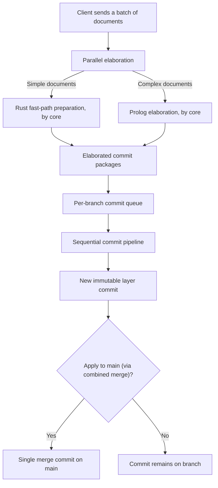

---
tags:
  - explanation
  - documents
  - advanced
title: 'The Write Path: Performance Internals'
nextjs:
  metadata:
    title: 'The Write Path: Performance Internals'
    description: >-
      High-level overview of how TerminusDB handles document writes, the commit
      pipeline introduced in 12.1, and how to optimize for throughput.
    keywords: >-
      git-for-data, acid knowledge graph, write performance, commit pipeline, parallel elaboration, document insert, batch writes, branch performance
    openGraph:
      images: https://assets.terminusdb.com/docs/technical-documentation-terminuscms-og.png
    alternates:
      canonical: https://terminusdb.com/docs/terminusdb-write-path/
media: []
---


This page documents functionality in the upcoming TerminusDB 12.1 release. Details may change before the final release.


TerminusDB is historically optimized for **read-heavy workloads** — versioning, querying, and graph navigation. Starting with version **12.1**, the write path is being redesigned so it can also serve as a high-throughput transactional database for many workloads. This page explains the new architecture at a high level and gives practical guidance on how to make the most of it.

## From retry loops to a commit pipeline

Before 12.1, multiple clients writing to the same branch could collide. When two writes arrived at nearly the same time, one would win and the other had to retry. Under heavy contention this created a spiral of retries and the effective throughput dropped sharply.

Version 12.1 replaces that model with a **commit pipeline**. Writes are not retried on collision; they are accepted, prepared, and queued to be committed in order. For the worst-case contention scenarios this improves document-write throughput by roughly **two orders of magnitude**. Rust also makes a debut in the write path for some documents, providing the performance foundation for the new pipeline.

## The request-to-commit funnel

The diagram below shows the main stages a write request travels through.

### What happens at each stage

1. **Batch of documents.** The client sends a request with many documents at once instead of one at a time. This is the most important optimization you can make.
2. **Parallel elaboration.** Each document is validated and expanded into the internal graph representation, done in parallel based on the number of cores or configured threads. Simple documents (random keying, no complexity) are sent through a Rust fast elaboration path; more complex documents are handled by Prolog.
3. **Commit packages.** The elaborated documents are packaged into a commit unit that can be appended to the branch history.
4. **Per-branch commit queue.** Each branch has its own queue. This isolates writes so that activity on one branch does not stall another. Potential intersection is verified, if no intersection, small commits skip the queue and go straight to the commit pipeline.
5. **Sequential commit pipeline.** Because every commit on a branch must have a well-defined place in the immutable history, commits are serialized (per branch). This is the fundamental per branch bottleneck. Commits can be done in parallel across different branches.
6. **Immutable layer commit.** Once a commit reaches the front of the queue, it is written as a new immutable layer.
7. **Apply/merge.** When work is done on a feature branch as part of many request, all of its new commits can be merged into the main branch in a single git-for-data apply operation.

## The commit bottleneck

The core constraint is that a branch is a linear chain of immutable commits. Even with perfect optimization, the current architecture supports roughly **30 commits per second per branch** (as of mid-2026). This is a property of the design, not a temporary bug.

The good news is that **many documents can be included in a single commit**. If you batch 1,000 documents into one commit, you can still write 30,000 documents per second on one branch. The key is to think in terms of **commits per second**, not documents per second.

## Branches act as independent throughput lanes

Every branch owns its own commit queue. Two branches on the same database can commit in parallel without interfering. The recommended pattern for high-throughput writes is:

- Work on **individual branches**.
- When the work is complete, use **apply** or **merge** to move the changes to the main branch as a single commit.
- Each database, including its metadata graph, is independent, so this pattern scales across databases as well.

This is the same idea as Git: do your work on a feature branch, then merge it back in one operation.

## Practical optimization guidelines

The following table summarizes the patterns that currently work best.

| Pattern | Recommendation | Why |
|---------|----------------|-----|
| Batch size | Up to **20,000+ documents per batch** | Large enough to amortize commit overhead; small enough to keep memory and latency reasonable |
| Parallel writers | **Two concurrent workers** per branch | Diminishing returns beyond two because commits are still serialized per branch |
| Branch strategy | One branch per workload stream, merge to main | Each branch has its own queue, so independent streams do not block each other |
| Document complexity | Keep documents simple when possible | Simple documents take the Rust fast path during elaboration, more paths are expected to get the fast path ahead |
| Commit granularity | One commit per batch, not one per document | Individual commits are the scarce resource |

In benchmarks, the combination of two parallel workers and 20,000-document batches has seen beyond **24,000 simple documents per second** on consumer hardware with parallel requests.

## Enterprise clustering

The Enterprise edition extends this model with clustering. Multiple machines can share the load, so throughput can grow beyond what a single server can provide. The same principles apply: batching, branch isolation, and merging to main remain the primary levers.

## When extra performance is planned

The commit pipeline itself continues getting improvements. Future releases will further reduce the per-commit cost, but the architectural shape is unlikely to change: branches serialize commits, batches hide commit latency, and branch-per-stream lets you scale horizontally across work streams.

## Summary

- Think in **commits per second**, not documents per second.
- **Batch** documents, aim for roughly up to 20,000 per batch, and use **parallel writers**.
- Use **branches as independent throughput lanes** and merge to main in one operation.
- **Simple documents** take the fast Rust path during elaboration.
- For the highest scale, use **Enterprise clustering** to distribute the load across data products.

TerminusDB remains a mostly-read system at heart. With the 12.1 write path it can now act as a transactional database for a wide set of workloads, including loading large corpora under contention.
